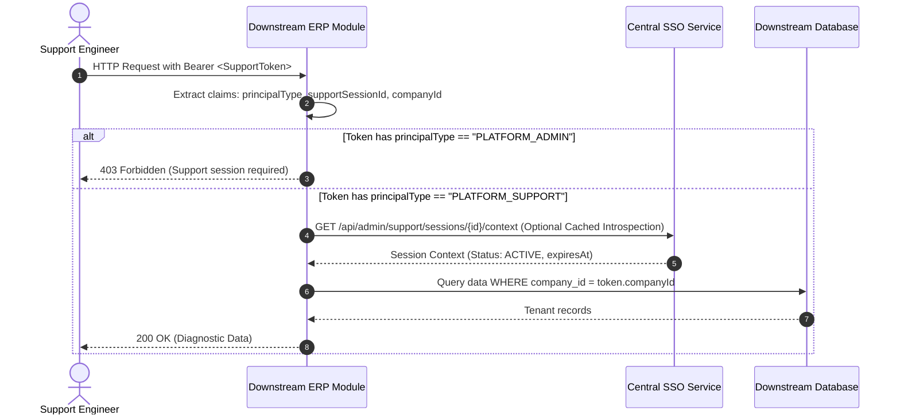

# Downstream ERP ↔ Platform Support Integration Contract

## 1. Overview

This specification establishes the technical contract that downstream ERP modules (e.g. Inventory, Billing, HR, Accounting) must follow when receiving requests initiated under a **Platform Support Access Session**.

When a platform operator diagnoses a tenant issue, the operator presents a JWT issued by the central SSO service with `principalType = "PLATFORM_SUPPORT"`.

---

## 2. JWT Claims for Support Access

The support access token issued by the SSO service contains the following claims:

```json
{
  "sub": "sarah.support@platform.com",
  "principalType": "PLATFORM_SUPPORT",
  "supportSessionId": "4b68427d-9443-4dc9-98e3-b09e25d2024b",
  "operatorAdminId": "1a2b3c4d-5e6f-7a8b-9c0d-1e2f3a4b5c6d",
  "organizationId": "3fa85f64-5717-4562-b3fc-2c963f66afa6",
  "organizationCode": "ACME_CORP",
  "companyId": "7c9e6679-7425-40de-944b-e07fc1f90ae7",
  "companyCode": "ACME_WEST",
  "moduleId": "9b1deb4d-3b7d-4bad-9bdd-2b0d7b3dcb6d",
  "moduleName": "INVENTORY",
  "roles": ["SUPPORT_OPERATOR"],
  "permissions": ["SUPPORT:READ", "SUPPORT:WRITE"],
  "iat": 1758688800,
  "exp": 1758696000
}
```

---

## 3. Downstream Validation Rules

Downstream ERP services MUST implement the following authorization checks in their request filter or security interceptor:

### Rule 1: Validate Principal Type
- If `principalType == "CUSTOMER"`: Process standard tenant user authorization (as defined in `downstream-erp-authorization-contract.md`).
- If `principalType == "PLATFORM_ADMIN"`: **REJECT** immediately with `403 Forbidden`. Platform admins cannot directly call downstream business ERP endpoints without a scoped support session.
- If `principalType == "PLATFORM_SUPPORT"`: Follow Support Access processing below.

### Rule 2: Verify Active Support Session State
Downstream ERPs can either:
- Rely on session introspection via `GET /api/admin/support/sessions/{supportSessionId}/context`, OR
- Validate the signed JWT with SSO public key / secret and verify `exp > now()`.

If the SSO returns `REVOKED` or `EXPIRED`, the ERP must reject the request with `401 Unauthorized`.

### Rule 3: Enforce Scoped Tenant Boundaries
Every database query and transaction executed under a `PLATFORM_SUPPORT` request MUST be automatically scoped to:
```sql
WHERE organization_id = :token_organizationId
  AND company_id = :token_companyId
```
The operator must NEVER be allowed to pass a query parameter modifying the targeted `organizationId` or `companyId`.

### Rule 4: Module Entitlement Check
Downstream ERP must verify that the incoming token's `moduleId` or `moduleName` matches the target service (e.g. `INVENTORY`). A support session issued for `BILLING` must not be accepted by `INVENTORY`.

### Rule 5: Audit Log Correlation
Any modification performed by the downstream ERP during a support session MUST record:
- `operator_id` (from `operatorAdminId`)
- `support_session_id` (from `supportSessionId`)
- `reason` / action taken
- Timestamp

---

## 4. Verification Flow



---

## 5. Security & Isolation Matrix

| Capability | Customer User | Platform Admin (Direct) | Support Session Operator |
|---|---|---|---|
| Access `/api/sso/**` | Yes | **No (403)** | Allowed for scoped session |
| Access `/api/admin/**` | **No (403)** | Yes (RBAC checked) | Read-only session context |
| Target Multiple Companies simultaneously | No (Bound to selected company) | N/A | **No (Strictly bound to 1 company)** |
| Cross-Tenant Querying | Forbidden | Aggregates only | **Strictly Forbidden** |
| Customer Password Required | Yes | No | **No** |
