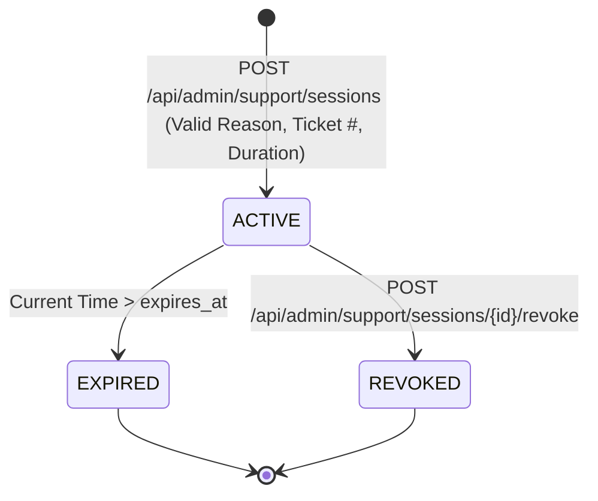

# Platform Support Access Lifecycle & Operator Manual

## 1. Overview & Purpose

In a multi-tenant SaaS ERP ecosystem, customers inevitably report data discrepancies, synchronization issues, or transaction errors that require diagnostic and remediation work by SaaS support engineers.

The **Platform Support Access Layer** provides a secure, audited, time-bound mechanism for SaaS platform operators to inspect and troubleshoot customer tenants **without**:
1. Asking for or resetting customer passwords
2. Impersonating customer users or faking user identities
3. Using backdoor database connections or bypass accounts
4. Having unconstrained, global cross-tenant access

Support sessions are scoped explicitly to `(Organization, Company, Module, Reason, Max Duration)` and are subjected to strict role authorization and append-only audit logging.

---

## 2. Security Guarantees & Constraints

| Security Property | Implementation Enforcement |
|---|---|
| **Zero Customer Password Sharing** | Support sessions are initiated using operator's own `PLATFORM_ADMIN` credentials; customer credentials are never requested, stored, or modified. |
| **Least Privilege Scope** | Every support session must target an existing `organizationId`, valid `companyId` belonging to that organization, and an enabled `moduleId`. |
| **Strict Time-Bound Validity** | Sessions have an explicit `expiresAt` (configurable up to a strict platform cap of 24 hours, defaulting to 2 hours). No indefinite access. |
| **Instant Revocability** | Sessions can be immediately revoked at any time (`POST /api/admin/support/sessions/{id}/revoke`), transitioning state to `REVOKED` and instantly invalidating the support token on subsequent requests. |
| **Tamper-Evident Audit Trail** | Every step—session creation, context check, mutation execution, and session revocation—is permanently recorded in `platform_audit_log` with admin ID, IP, user-agent, before/after details, and timestamp. |
| **Role-Based Mutation Gate** | `READ_ONLY_SUPPORT` operators can view records and diagnostics, but cannot invoke support mutations. Only `SUPPORT_ADMIN` and `SUPER_ADMIN` can perform authorized support mutations. |
| **Organization AccessMode Respect** | If an organization is marked `BLOCKED`, support session initiation is strictly prevented. If marked `READ_ONLY`, write mutations are rejected. |

---

## 3. Support Session Lifecycle State Machine



### State Transitions:
1. **ACTIVE**:
   - Created by an active `PlatformAdmin` with `SUPPORT:CREATE` or `ALL:ALL` permission.
   - Generates a scoped support JWT with claim `principalType = "PLATFORM_SUPPORT"` and `supportSessionId`.
   - Token is valid across downstream ERP services that validate against the SSO or inspect session state.
2. **REVOKED**:
   - Operator or security administrator calls `/revoke`.
   - `status` is set to `REVOKED` and `revokedAt` is set to `Instant.now()`.
   - Any API request bearing this token is immediately rejected with `401 Unauthorized ("Support access session is no longer active")`.
3. **EXPIRED**:
   - `expiresAt < Instant.now()`.
   - Evaluated dynamically on every request. Rejection with `401 Unauthorized ("Support access session has expired")`.

---

## 4. Operator Step-by-Step Workflow

### Step 1: Authenticate as Platform Operator
```http
POST /api/admin/auth/login
Content-Type: application/json

{
  "email": "sarah.support@platform.com",
  "password": "StrongOperatorPassword123!"
}
```
**Response**: Returns `token` (Operator JWT with `principalType = "PLATFORM_ADMIN"`).

---

### Step 2: Search and Locate Customer Organization
```http
GET /api/admin/organizations?search=Acme&page=0&size=10
Authorization: Bearer <operator_token>
```
Review the organization summary, subscription state (`ACTIVE`), and verify `accessMode != BLOCKED`.

---

### Step 3: Inspect Organization Hierarchy & Target Company
```http
GET /api/admin/organizations/3fa85f64-5717-4562-b3fc-2c963f66afa6
Authorization: Bearer <operator_token>
```
Identify the target `companyId` (e.g., `Acme West Division`) and the troubled `moduleId` (e.g., `INVENTORY`).

---

### Step 4: Initiate Scoped Support Access Session
```http
POST /api/admin/support/sessions
Authorization: Bearer <operator_token>
Content-Type: application/json

{
  "organizationId": "3fa85f64-5717-4562-b3fc-2c963f66afa6",
  "companyId": "7c9e6679-7425-40de-944b-e07fc1f90ae7",
  "moduleId": "9b1deb4d-3b7d-4bad-9bdd-2b0d7b3dcb6d",
  "reason": "Investigating stuck inventory batch #8491 reported by customer",
  "ticketReference": "JIRA-48192",
  "durationMinutes": 60
}
```
**Response**:
```json
{
  "sessionId": "4b68427d-9443-4dc9-98e3-b09e25d2024b",
  "supportToken": "eyJhbGciOiJIUzI1NiIs...",
  "organizationId": "3fa85f64-5717-4562-b3fc-2c963f66afa6",
  "companyId": "7c9e6679-7425-40de-944b-e07fc1f90ae7",
  "companyName": "Acme West Division",
  "moduleId": "9b1deb4d-3b7d-4bad-9bdd-2b0d7b3dcb6d",
  "moduleName": "INVENTORY",
  "status": "ACTIVE",
  "expiresAt": "2026-09-24T05:30:00Z"
}
```

---

### Step 5: Execute Downstream Diagnostics and Remediation
The operator sets `Authorization: Bearer <supportToken>` in diagnostic tooling or downstream ERP APIs.

Downstream ERP / SSO checks verify:
- Token has `principalType: "PLATFORM_SUPPORT"`
- Session is active and unexpired
- All database queries are filtered by `organizationId` and `companyId`

If a corrective mutation is required via SSO:
```http
POST /api/admin/support/sessions/4b68427d-9443-4dc9-98e3-b09e25d2024b/mutate
Authorization: Bearer <operator_token>
Content-Type: application/json

{
  "targetResourceType": "INVENTORY_BATCH",
  "targetResourceId": "batch-8491",
  "action": "RESYNC_LEDGER",
  "reason": "Resolving stranded state per ticket JIRA-48192",
  "payload": {
    "expectedQuantity": 150,
    "forceUnblock": true
  }
}
```
*Note: Only operators with `SUPPORT_ADMIN` or `SUPER_ADMIN` can execute mutations. `READ_ONLY_SUPPORT` will receive `403 Forbidden`.*

---

### Step 6: Close / Revoke Session Immediately Upon Completion
```http
POST /api/admin/support/sessions/4b68427d-9443-4dc9-98e3-b09e25d2024b/revoke
Authorization: Bearer <operator_token>
Content-Type: application/json

{
  "reason": "Troubleshooting completed; batch resynced and verified with customer"
}
```
Status becomes `REVOKED`. Access token is instantly dead.
